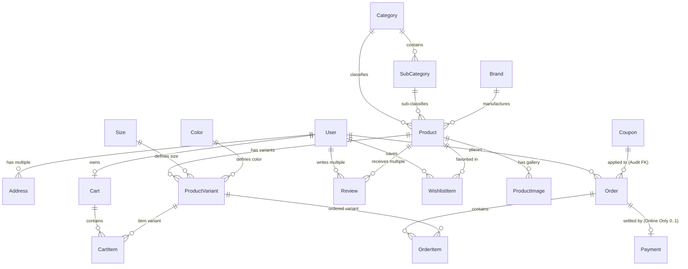
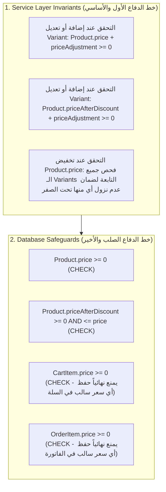

# Milestone 1: Database Design & Relational Modeling (Final Decision Revision)

- **Status:** DONE / APPROVED ✅
- **Domain:** Clothing E-Commerce Store
- **Stack:** Node.js, NestJS, Prisma ORM, PostgreSQL (Native Types, Checks & Partial Indexes)
- **Entities Count:** 18 Entities
- **Schema File:** [prisma/schema.prisma](file:///d:/Fares/E-commerce/prisma/schema.prisma)

---

## 1. Entities Overview (حصر وتدقيق الكيانات الـ 18)

| # | الكيان (Entity) | الدور في النظام (System Role) | علاقات الكيان (Cardinality) |
| :--- | :--- | :--- | :--- |
| 1 | **User** | حسابات العملاء، والمديرين، وتأمين الدخول (JWT, Roles, Profile). | `1..N Address`, `1..1 Cart`, `1..N Order`, `1..N Review`, `1..N WishlistItem` |
| 2 | **Address** | عناوين الشحن والتوصيل المتعددة للعميل. | `N..1 User` |
| 3 | **Category** | الأقسام الرئيسية للملابس (Men, Women, Kids). | `1..N SubCategory`, `1..N Product` |
| 4 | **SubCategory** | الأقسام الفرعية التابعة للقسم الرئيسي (Shirts, Pants, Dresses). | `N..1 Category`, `1..N Product` |
| 5 | **Brand** | العلامات التجارية والماركات (Zara, Nike, Adidas). | `1..N Product` |
| 6 | **Product** | المنتج الأساسي، الوصف، السعر المرجعي، القسم، الماركة. | `N..1 Category`, `N..1 SubCategory`, `N..1 Brand`, `1..N ProductImage`, `1..N ProductVariant`, `1..N Review`, `1..N WishlistItem` |
| 7 | **ProductImage** | معرض صور المنتج الإضافية. | `N..1 Product` (Cascade on hard delete) |
| 8 | **Size** | جدول المقاسات القياسي (S, M, L, XL, 32, 34). | `1..N ProductVariant` |
| 9 | **Color** | جدول الألوان مع كود الهيكس (Navy Blue, Crimson Red, Black). | `1..N ProductVariant` |
| 10 | **ProductVariant** | التوليفة الفعلية للشراء والمخزون (`Product` + `Size` + `Color` + `priceAdjustment` + `stockQuantity` + `SKU`). | `N..1 Product`, `N..1 Size`, `N..1 Color`, `1..N CartItem`, `1..N OrderItem` |
| 11 | **WishlistItem** | قائمة المنتجات المفضلة لدى المستخدم. | `N..1 User`, `N..1 Product` |
| 12 | **Cart** | سلة التسوق النشطة للمستخدم. | `1..1 User`, `1..N CartItem` |
| 13 | **CartItem** | البنود المضافة بالسلة، مرتبطة إجبارياً بـ `ProductVariant`. | `N..1 Cart`, `N..1 ProductVariant` |
| 14 | **Coupon** | كوبونات الخصم، نسبها، حدودها، وصلاحيتها. | `1..N Order` (Audit snapshot) |
| 15 | **Review** | تقييمات ومراجعات العملاء للمنتجات. | `N..1 User`, `N..1 Product` (UNIQUE: user per product) |
| 16 | **Order** | سجل الطلب القانوني والمالي مع Snapshot كامل للمبالغ والعنوان والكوبون. | `N..1 User`, `1..N OrderItem`, `1..0..1 Payment`, `N..1 Coupon?` |
| 17 | **OrderItem** | بنود الطلب مع تثبيت سعر وتفاصيل المقاس واللون وصورة المنتج وقت الشراء. | `N..1 Order`, `N..1 ProductVariant` (RESTRICT on delete) |
| 18 | **Payment** | سجل تسوية الدفع الإلكتروني (Stripe) لطلبات الأونلاين فقط (0..1). | `1..1 Order` (Unique orderId) |

---

## 2. Final Relational ER Diagram (مخطط العلاقات النهائي)

> [!IMPORTANT]
> **علاقة الـ Review:**
> - المستخدم يكتب مراجعات متعددة لمنتجات مختلفة: `User 1 --- 0..N Review`.
> - المنتج يستقبل مراجعات متعددة من مستخدمين مختلفين: `Product 1 --- 0..N Review`.
> - القيد الصارم: `UNIQUE(userId, productId)` يمنع المستخدم من تقييم نفس المنتج مرتين.

---

## 3. Detailed Entity Specifications

### 3.1. Authentication & Users
- **`User`**:
  - `id`: UUID `@id @default(uuid())`
  - `name`: `String`
  - `email`: `String @unique`
  - `password`: `String` (Hashed with bcrypt/argon2)
  - `phone`: `String?`
  - `role`: `RoleEnum @default(USER)` (`USER`, `ADMIN`)
  - `isActive`: `Boolean @default(true)` (Soft delete support)
  - `passwordChangedAt`: `DateTime?`
  - `passwordResetCode`: `String?`
  - `passwordResetExpires`: `DateTime?`
  - `passwordResetVerified`: `Boolean?`
  - `createdAt`: `DateTime @default(now())`
  - `updatedAt`: `DateTime @updatedAt`
- **`Address`**:
  - `id`: UUID `@id @default(uuid())`
  - `userId`: UUID (FK -> `User.id` ON DELETE CASCADE)
  - `alias`: `String` (e.g. "Home", "Work")
  - `details`: `String`
  - `phone`: `String`
  - `city`: `String`
  - `postalCode`: `String?`
  - `isDefault`: `Boolean @default(false)`
  - `createdAt`: `DateTime @default(now())`
  - `updatedAt`: `DateTime @updatedAt`

### 3.2. Taxonomy
- **`Category`**:
  - `id`: UUID `@id @default(uuid())`
  - `name`: `String @unique`
  - `slug`: `String @unique`
  - `image`: `String?`
  - `isActive`: `Boolean @default(true)`
  - `createdAt`: `DateTime @default(now())`
  - `updatedAt`: `DateTime @updatedAt`
- **`SubCategory`**:
  - `id`: UUID `@id @default(uuid())`
  - `name`: `String`
  - `slug`: `String @unique`
  - `categoryId`: UUID (FK -> `Category.id` ON DELETE RESTRICT)
  - `isActive`: `Boolean @default(true)`
  - `createdAt`: `DateTime @default(now())`
  - `updatedAt`: `DateTime @updatedAt`
  - *Composite Unique:* `@@unique([id, categoryId])` (لتمكين Composite Foreign Key مع Product).
- **`Brand`**:
  - `id`: UUID `@id @default(uuid())`
  - `name`: `String @unique`
  - `slug`: `String @unique`
  - `image`: `String?`
  - `isActive`: `Boolean @default(true)`
  - `createdAt`: `DateTime @default(now())`
  - `updatedAt`: `DateTime @updatedAt`

### 3.3. Product & Variants (Clothing Specific)
- **`Product`**:
  - `id`: UUID `@id @default(uuid())`
  - `title`: `String`
  - `slug`: `String @unique`
  - `description`: `String` (Text)
  - `price`: `Decimal(10,2)` (DB CHECK `price >= 0`)
  - `priceAfterDiscount`: `Decimal(10,2)?` (DB CHECK `priceAfterDiscount >= 0 AND priceAfterDiscount <= price`)
  - `imageCover`: `String`
  - `sold`: `Int @default(0)`
  - `ratingsAverage`: `Decimal(3,2) @default(0.0)`
  - `ratingsQuantity`: `Int @default(0)`
  - `categoryId`: UUID (FK -> `Category.id` ON DELETE RESTRICT)
  - `subcategoryId`: UUID?
  - `brandId`: UUID? (FK -> `Brand.id` ON DELETE RESTRICT)
  - `isActive`: `Boolean @default(true)` (Soft delete support)
  - `createdAt`: `DateTime @default(now())`
  - `updatedAt`: `DateTime @updatedAt`
  - *Composite FK:* `FOREIGN KEY (subcategoryId, categoryId) REFERENCES SubCategory(id, categoryId)` لضمان مطابقة الـ SubCategory للـ Category هندسياً.
- **`ProductImage`**:
  - `id`: UUID `@id @default(uuid())`
  - `productId`: UUID (FK -> `Product.id` ON DELETE CASCADE)
  - `url`: `String`
  - `displayOrder`: `Int @default(0)`
  - `createdAt`: `DateTime @default(now())`
- **`Size`**:
  - `id`: UUID `@id @default(uuid())`
  - `name`: `String @unique` (S, M, L, XL, 32, 34)
  - `code`: `String @unique`
  - `displayOrder`: `Int @default(0)`
- **`Color`**:
  - `id`: UUID `@id @default(uuid())`
  - `name`: `String`
  - `hexCode`: `String @unique`
- **`ProductVariant`**:
  - `id`: UUID `@id @default(uuid())`
  - `productId`: UUID (FK -> `Product.id` ON DELETE RESTRICT)
  - `sizeId`: UUID (FK -> `Size.id` ON DELETE RESTRICT)
  - `colorId`: UUID (FK -> `Color.id` ON DELETE RESTRICT)
  - `sku`: `String @unique`
  - `priceAdjustment`: `Decimal(10,2) @default(0.00)` (فرق السعر عن سعر المنتج الأساسي: يقبل قيمة موجبة أو سالبة)
  - `stockQuantity`: `Int @default(0)` (DB CHECK `stockQuantity >= 0`)
  - `isDefault`: `Boolean @default(false)`
  - `isActive`: `Boolean @default(true)` (Soft delete support)
  - `createdAt`: `DateTime @default(now())`
  - `updatedAt`: `DateTime @updatedAt`
  - *Constraints:*
    - `@@unique([productId, sizeId, colorId])`
    - *PostgreSQL Partial Unique Index:* `CREATE UNIQUE INDEX "idx_product_variant_single_default" ON "ProductVariant"("productId") WHERE "isDefault" = true;`

### 3.4. Wishlist & Cart
- **`WishlistItem`**:
  - `id`: UUID `@id @default(uuid())`
  - `userId`: UUID (FK -> `User.id` ON DELETE CASCADE)
  - `productId`: UUID (FK -> `Product.id` ON DELETE CASCADE)
  - `createdAt`: `DateTime @default(now())`
  - *Unique:* `@@unique([userId, productId])` (الفهرس المركب يخدم أيضاً البحث بـ userId).
- **`Cart`**:
  - `id`: UUID `@id @default(uuid())`
  - `userId`: UUID `@unique` (FK -> `User.id` ON DELETE CASCADE)
  - `createdAt`: `DateTime @default(now())`
  - `updatedAt`: `DateTime @updatedAt`
- **`CartItem`**:
  - `id`: UUID `@id @default(uuid())`
  - `cartId`: UUID (FK -> `Cart.id` ON DELETE CASCADE)
  - `variantId`: UUID (FK -> `ProductVariant.id` ON DELETE RESTRICT)
  - `quantity`: `Int @default(1)` (DB CHECK `quantity >= 1`)
  - `price`: `Decimal(10,2)` (DB CHECK `price >= 0` - سعر الوحدة الفعلي المحسوب وقت الإضافة/التحديث)
  - `createdAt`: `DateTime @default(now())`
  - `updatedAt`: `DateTime @updatedAt`
  - *Unique:* `@@unique([cartId, variantId])` (الفهرس المركب يخدم أيضاً البحث بـ cartId).

### 3.5. Marketing & Reviews
- **`Coupon`**:
  - `id`: UUID `@id @default(uuid())`
  - `code`: `String @unique`
  - `discountType`: `DiscountTypeEnum` (`PERCENTAGE`, `FIXED`)
  - `discountValue`: `Decimal(10,2)` (DB CHECK `discountValue > 0`)
  - `minOrderValue`: `Decimal(10,2) @default(0.00)` (DB CHECK `minOrderValue >= 0`)
  - `usageLimit`: `Int?` (DB CHECK `usageLimit IS NULL OR usageLimit >= 0` - Null = Unlimited, 0 = Inactive)
  - `usedCount`: `Int @default(0)` (DB CHECK `usedCount >= 0`)
  - `isActive`: `Boolean @default(true)`
  - `expiresAt`: `DateTime?` (Null = No expiration)
  - `createdAt`: `DateTime @default(now())`
  - `updatedAt`: `DateTime @updatedAt`
  - *Check Constraint:* `CHECK (discountType != 'PERCENTAGE' OR discountValue <= 100)`
- **`Review`**:
  - `id`: UUID `@id @default(uuid())`
  - `userId`: UUID (FK -> `User.id` ON DELETE CASCADE)
  - `productId`: UUID (FK -> `Product.id` ON DELETE CASCADE)
  - `rating`: `Int` (DB CHECK `rating >= 1 AND rating <= 5`)
  - `title`: `String?`
  - `comment`: `String?`
  - `createdAt`: `DateTime @default(now())`
  - `updatedAt`: `DateTime @updatedAt`
  - *Unique:* `@@unique([userId, productId])`

### 3.6. Orders & Checkout
- **`Order`**:
  - `id`: UUID `@id @default(uuid())`
  - `orderNumber`: `Int @default(autoincrement()) @unique` (Human-readable #1001)
  - `userId`: UUID (FK -> `User.id` ON DELETE RESTRICT)
  - `paymentMethod`: `PaymentMethodEnum` (`CASH`, `ONLINE`)
  - `isPaid`: `Boolean @default(false)`
  - `paidAt`: `DateTime?`
  - `isDelivered`: `Boolean @default(false)`
  - `deliveredAt`: `DateTime?`
  - `status`: `OrderStatusEnum @default(PENDING)` (`PENDING`, `PROCESSING`, `SHIPPED`, `DELIVERED`, `CANCELLED`)
  - **Financial Breakdown (Decimal 12,2):**
    - `subtotal`: `Decimal(12,2)` (DB CHECK `subtotal >= 0`)
    - `discountAmount`: `Decimal(12,2) @default(0.00)` (DB CHECK `discountAmount >= 0 AND discountAmount <= subtotal`)
    - `shippingPrice`: `Decimal(12,2) @default(0.00)` (DB CHECK `shippingPrice >= 0`)
    - `taxPrice`: `Decimal(12,2) @default(0.00)` (DB CHECK `taxPrice >= 0`)
    - `totalOrderPrice`: `Decimal(12,2)` (DB CHECK `totalOrderPrice >= 0 AND totalOrderPrice = subtotal - discountAmount + shippingPrice + taxPrice`)
  - **Coupon Snapshot (حماية الطلب التاريخي):**
    - `couponId`: UUID? (FK -> `Coupon.id` ON DELETE SET NULL - للتحليل والإحصائيات فقط)
    - `couponCode`: `String?`
    - `couponDiscountType`: `DiscountTypeEnum?`
    - `couponDiscountValue`: `Decimal(10,2)?`
  - **Shipping Address Snapshot:**
    - `shippingAddressDetails`: `String`
    - `shippingAddressPhone`: `String`
    - `shippingAddressCity`: `String`
    - `shippingPostalCode`: `String?`
  - `createdAt`: `DateTime @default(now())`
  - `updatedAt`: `DateTime @updatedAt`
- **`OrderItem`**:
  - `id`: UUID `@id @default(uuid())`
  - `orderId`: UUID (FK -> `Order.id` ON DELETE CASCADE)
  - `variantId`: UUID (FK -> `ProductVariant.id` ON DELETE RESTRICT)
  - `quantity`: `Int` (DB CHECK `quantity >= 1`)
  - `price`: `Decimal(10,2)` (DB CHECK `price >= 0` - سعر الوحدة الفعلي الثابت وقت الشراء)
  - `productTitle`: `String` (Snapshot لاسم المنتج)
  - `sizeName`: `String` (Snapshot للمقاس وقت الشراء)
  - `colorName`: `String` (Snapshot للون وقت الشراء)
  - `sku`: `String` (Snapshot لكود المخزن وقت الشراء)
  - `imageCover`: `String` (Snapshot لصورة المنتج لحماية سجل الفاتورة حتى لو حذفت صور المعرض)
  - `createdAt`: `DateTime @default(now())`
- **`Payment` (Online Settlement 0..1)**:
  - `id`: UUID `@id @default(uuid())`
  - `orderId`: UUID `@unique` (FK -> `Order.id` ON DELETE RESTRICT)
  - `paymentProvider`: `String @default("STRIPE")`
  - `stripeSessionId`: `String? @unique`
  - `stripePaymentIntentId`: `String? @unique`
  - `amount`: `Decimal(12,2)`
  - `currency`: `String @default("EGP")`
  - `status`: `PaymentStatusEnum @default(PENDING)` (`PENDING`, `SUCCESS`, `FAILED`, `REFUNDED`)
  - `receiptUrl`: `String?`
  - `rawWebhookPayload`: `Json?`
  - `createdAt`: `DateTime @default(now())`
  - `updatedAt`: `DateTime @updatedAt`

---

## 4. Architectural Deep Dive: Coupon & Online Payment Lifecycle

### 4.1. مقارنة خيارات احتساب `Coupon.usedCount` (A vs B vs C)

السيناريو:
`Create Order -> Create Payment/Stripe Session -> Customer may pay or abandon -> Stripe Webhook -> SUCCESS / FAILED / EXPIRED`

| معيار المقارنة | Option A: احتساب فوري عند إنشاء الـ Order | Option B: احتساب مؤجل عند نجاح Webhook الدفع | Option C (المعتمد): حجز فوري مع تحرير تلقائي (Reserve & Revert) |
| :--- | :--- | :--- | :--- |
| **Race Conditions** | محمي تماماً بـ Conditional Atomic Update. | **خطر شديد جداً!** عدة عملاء يمكنهم فتح جلسة دفع لنفس الكوبون في نفس اللحظة. | محمي تماماً؛ `usageLimit` يستحيل تجاوزه تحت أي ظرف تزامن. |
| **Abandoned Orders** | **سيئ جداً؛** يضيع الكوبون على المتجر لو فتح العميل Stripe وأغلق الصفحة ولم يدفع. | ممتاز للطلبات المتروكة؛ لا يتم استهلاك الحصة. | **ممتاز؛** تنتهي جلسة Stripe (TTL) فيقوم الـ Webhook بتحرير الحصة تلقائياً. |
| **Payment Failures** | يفقد العميل حقه في الكوبون حتى لو بطاقته رُفضت. | لا يستهلك الكوبون. | **عادل ومثالي؛** عند فشل الدفع يعاد الكوبون فوراً لحساب العميل. |
| **تجاوز `usageLimit`** | مستحيل. | **محتمل جداً (Overselling)؛** قد يدفع 5 عملاء لكوبون متبقي فيه استخدام واحد، مما يجبرك على Refund أموالهم! | **مستحيل تماماً.** |
| **Database Transactions** | معاملة واحدة بسيطة. | معاملات موزعة ومعقدة. | معاملة ذرية عند الإنشاء + معاملة تحديث عند استقبال الـ Webhook. |
| **Data Consistency** | عالية. | منخفضة وعرضة لعدم الاتساق بين Stripe والـ DB. | **أعلى درجات الاتساق والنزاهة المالية.** |

### 4.2. التوصية المعتمدة (Recommendation): Option C (Two-Phase Reserve & Revert)

**آلية العمل المعتمدة هندسياً بالتوافق مع Stripe Webhook:**

1. **الطلبات النقدية (Cash On Delivery):**
   - ينشأ الطلب بحالة `PENDING` وطريقة دفع `CASH`.
   - يتم احتساب الكوبون ذرياً: `UPDATE "Coupon" SET "usedCount" = "usedCount" + 1 ...`.
   - يظل مستخدماً إلا إذا قام العميل أو الأدمن بعمل `CANCEL` للطلب قبل خروجه للشحن.
2. **الطلبات الإلكترونية (Online Orders - Stripe):**
   - عند إنشاء الطلب: يتم حجز الكوبون فورياً بالـ Conditional Atomic Update في نفس Transaction إنشاء الـ Order والمخزون.
   - تنشأ جلسة الدفع في Stripe بـ TTL محدد (مثلاً 30 دقيقة افتراضياً في Stripe Checkout).
   - **حالة النجاح (`checkout.session.completed` / `payment_intent.succeeded`):**
     - يتلقى الـ Webhook إشعار النجاح.
     - يتم تحديث `Payment.status = SUCCESS` و `Order.isPaid = true` و `Order.status = PROCESSING`.
     - يثبت استخدام الكوبون (يبقى `usedCount` كما هو).
   - **حالة الفشل أو الإلغاء (`payment_intent.payment_failed`):**
     - يتم تحديث `Payment.status = FAILED` و `Order.status = CANCELLED`.
     - يتم تحرير حصة الكوبون فوراً:
       `UPDATE "Coupon" SET "usedCount" = GREATEST("usedCount" - 1, 0) WHERE "id" = :couponId`
     - يتم أيضاً إعادة المخزون المحجوز للمنتجات!
   - **حالة انتهاء الجلسة دون دفع (`checkout.session.expired` - Abandoned):**
     - عندما يترك العميل الصفحة دون سداد، ترسل Stripe حدث `checkout.session.expired`.
     - يحدث السيرفر `Payment.status = FAILED` و `Order.status = CANCELLED`.
     - يحرر الكوبون تلقائياً: `GREATEST("usedCount" - 1, 0)` ويعيد المخزون للبيع.
3. **إلغاء الطلب (Order CANCELLED):**
   - لو ألغى العميل أو الأدمن الطلب قبل الشحن: يحرر الكوبون ويسترد المخزون.
4. **استرداد الأموال (Refund):**
   - يتم تسجيل الـ Refund في جدول `Payment` (`status = REFUNDED`) وإصدار الاسترداد عبر Stripe API. استرداد القيمة المالية لا يعيد تفعيل كوبون استُخدم في طلب شُحن واكتمل بالفعل إلا بقرار إداري.

---

## 5. Pricing Architecture & Formula Resolution

### 5.1. المعادلات الحسابية المعتمدة

لأي منتج ومقاس في المتجر:
- **`effectivePrice` (السعر الأصلي للمقاس قبل خصم المنتج):**
  $$\text{effectivePrice} = \text{Product.price} + \text{ProductVariant.priceAdjustment}$$
- **`effectiveDiscountedPrice` (السعر بعد خصم المنتج إن وجد):**
  $$\text{effectiveDiscountedPrice} = \begin{cases} \text{Product.priceAfterDiscount} + \text{ProductVariant.priceAdjustment} & \text{if } \text{Product.priceAfterDiscount} \neq \text{NULL} \\ \text{NULL} & \text{if } \text{Product.priceAfterDiscount} = \text{NULL} \end{cases}$$
- **`finalUnitPrice` (سعر الوحدة النهائي المحصل في السلة والطلب):**
  $$\text{finalUnitPrice} = \text{effectiveDiscountedPrice} \;\text{??}\; \text{effectivePrice}$$

#### مثال توضيحي بالأرقام:
إذا كان:
- `Product.price = 1000`
- `Product.priceAfterDiscount = 800`
- `ProductVariant.priceAdjustment = -100`

فإن:
- `effectivePrice = 1000 + (-100) = 900`
- `effectiveDiscountedPrice = 800 + (-100) = 700`
- `finalUnitPrice = 700` (يتم تحصيله وتثبيته في `CartItem.price` و `OrderItem.price`).

أما إذا كان `Product.priceAfterDiscount = NULL`:
- `effectivePrice = 900`
- `effectiveDiscountedPrice = NULL`
- `finalUnitPrice = 900`

---

## 6. Constraint Ownership (حدود المسؤولية بين DB والـ Service)

> [!IMPORTANT]
> **قاعدة تقنية جوهرية في PostgreSQL:**
> قيود `CHECK` Constraints في محرك PostgreSQL تعمل حصرياً على مستوى أعمدة السطر الواحد في نفس الجدول (`Intra-Row`). يستحيل في SQL القياسي كتابة `CHECK` Constraint في جدول `ProductVariant` يعتمد على قراءة عمود `price` من جدول `Product` دون اللجوء إلى Subqueries (وهي ممنوعة داخل CHECK constraints في PostgreSQL).
> بناءً عليه، تم توزيع المسؤوليات بصرامة هندسية لا تقبل اللبس:

- **مسؤولية الـ Service (Service Invariant):** التحقق المسبق عند إنشاء أو تحديث المقاسات وأسعار المنتجات ورمي `BadRequestException` في حال نتج أي سعر سالب.
- **مسؤولية الـ Database (DB Safeguard):** تفرض جداول `CartItem` و `OrderItem` قيود `CHECK ("price" >= 0)` كحزام أمان غير قابل للاختراق يضمن استحالة إتمام عملية شراء أو إضافة لسلة بسعر سالب حتى لو حدث أي خلل برمجي.

---

## 7. Corrected Delete Strategy (Category / SubCategory / Brand)

> [!CAUTION]
> **تصحيح الصياغة وتوضيح الـ Relational Integrity:**
> قيد `ON DELETE RESTRICT` في PostgreSQL يمنع حذف الـ `Category` أو الـ `SubCategory` أو الـ `Brand` إذا كان هناك **أي سجل منتج (`Product`) في قاعدة البيانات يرتبط بها**، سواء كان هذا المنتج **نشطاً (`isActive = true`) أو محذوفاً برمجياً (`isActive = false`)**.
> 
> **السبب:** المنتج المحذوف بـ Soft Delete يظل سطراً فيزيائياً قائماً في جدول `Product`، والـ Foreign Key يظل سارياً عليه بنسبة 100%. لحذف القسم نهائياً من الـ DB، يجب إما نقل المنتجات المرتبطة به إلى قسم آخر، أو حذفها نهائياً بـ Hard Delete في حال عدم ارتباطها بطلبات سابقة.

---

## 8. Optimized Indexing Strategy

| الجدول (Table) | الفهرس (Index) | التبرير ونمط الاستعلام الحقيقي (Query Pattern) |
| :--- | :--- | :--- |
| `Product` | `slug` (Unique B-tree) | استرجاع صفحة تفاصيل المنتج بالرابط (`/products/:slug`). |
| `Product` | `(categoryId, isActive)` | تصفح المنتجات النشطة بالقسم (`WHERE categoryId = ? AND isActive = true`). |
| `Product` | `(brandId, isActive)` | تصفية المنتجات النشطة بالماركة (`WHERE brandId = ? AND isActive = true`). |
| `Product` | `price` (B-tree) | فهرس واحد يخدم الترتيب تصاعدياً `ASC` وتنازلياً `DESC` بكفاءة متطابقة عبر الـ Backward Scan. |
| `Product` | `ratingsAverage` (B-tree) | فرز المنتجات حسب الأعلى تقييماً (`ORDER BY ratingsAverage DESC`). |
| `ProductVariant` | `sku` (Unique B-tree) | البحث المباشر برمز المخزن SKU. |
| `ProductVariant` | `(productId, sizeId, colorId)` (Unique) | يمنع تكرار نفس تركيبة المقاس واللون لنفس المنتج. |
| `ProductVariant` | `(productId, isActive, createdAt)` | يخدم استعلام الـ `VariantResolver` والفرز القطعي (`ORDER BY createdAt ASC`). |
| `ProductVariant` | `("productId") WHERE isDefault = true` (Partial Unique) | يضمن مقاس افتراضي واحد كحد أقصى لكل منتج على مستوى محرك الـ DB. |
| `CartItem` | `(cartId, variantId)` (Unique B-tree) | فهرس مركب يمنع تكرار المقاس ويخدم استعلام `WHERE cartId = ?` تلقائياً كونه العمود الأول. |
| `WishlistItem` | `(userId, productId)` (Unique B-tree) | يمنع تكرار المنتج في المفضلة ويخدم استعلام `WHERE userId = ?` تلقائياً. |
| `Review` | `(productId, createdAt DESC)` | جلب تقييمات المنتج مقسمة على صفحات ومرتبة من الأحدث للأقدم. |
| `Review` | `(userId, productId)` (Unique B-tree) | يمنع العميل من تقييم نفس المنتج مرتين. |
| `Order` | `(userId, createdAt DESC)` | شاشة "طلباتي" الخاصة بالمستخدم لعرض أحدث الطلبات أولاً. |
| `Order` | `orderNumber` (Unique B-tree) | البحث المباشر برقم الفاتورة البشري (`#1001`). |
| `Coupon` | `code` (Unique B-tree) | التحقق السريع من كود الخصم في السلة. |

---

## 9. Corrected Comprehensive Test Matrix (22 Test Cases)

تم فصل اختبارات الـ Service عن اختبارات الـ Database بدقة:

| كود الاختبار | نوع الاختبار (Layer) | الهدف والخاصية المختبرة | السيناريو والمدخلات | النتيجة المطلوبة للنجاح |
| :--- | :--- | :--- | :--- | :--- |
| **TC-DB-01** | Database (Partial Index) | منع تعدد المقاسات الافتراضية | محاولة إنشاء 2 Variants لنفس المنتج بـ `isDefault = true`. | يفشل بـ Unique Constraint Violation من PostgreSQL. |
| **TC-DB-02** | Database (CHECK) | منع المخزون السالب | محاولة إدخال `stockQuantity = -5` في `ProductVariant`. | يفشل بـ `chk_variant_stock_non_negative`. |
| **TC-DB-03** | Database (CHECK) | الحد الأدنى لكمية السلة | محاولة تعيين `quantity = 0` أو `-1` في `CartItem`. | يفشل بـ `chk_cart_item_quantity_positive`. |
| **TC-DB-04** | Database (CHECK) | منطقية السعر والخصم الأساسي | إدخال منتج بسعر `100` وسعر بعد الخصم `150`. | يفشل بـ `chk_product_discount_valid`. |
| **TC-DB-05** | Database (Composite FK) | مطابقة القسم الرئيسي والفرعي | ربط منتج بـ `categoryId = Men` مع `subcategoryId = Dresses` (التابع لـ Women). | يرفض الـ Composite Foreign Key حفظ السجل نهائياً. |
| **TC-DB-06** | Database (CHECK) | نطاق تقييم المراجعة | إدخال Review بقيمة `rating = 6` أو `rating = 0`. | يفشل بـ `chk_review_rating_range`. |
| **TC-DB-07** | Database (CHECK) | حماية نسبة الكوبون | محاولة إنشاء كوبون نسبة مئوية بخصم `120%`. | يفشل بـ `chk_coupon_percentage_limit`. |
| **TC-DB-08** | Database (Snapshot) | ثبات التاريخ المالي للطلب | تعديل نسبة الكوبون أو حذفه بعد إنشاء الطلب. | تبقى قيم `discountAmount` و `couponDiscountValue` في `Order` ثابتة. |
| **TC-DB-09** | Database (Optional 0..1) | استقلالية الدفع كاش vs أونلاين | إنشاء طلب كاش والتأكد من عدم توليد سجل في `Payment`. | ينشأ الطلب وتكون علاقة `order.payment` خالية (`null`). |
| **TC-DB-10** | Database (FK RESTRICT) | حماية الأقسام بالحذف المقيد | محاولة حذف `Category` ترتبط بمنتجات (سواء كانت نشطة أو Soft Deleted). | تمنع الـ Database الحذف بخطأ `ON DELETE RESTRICT`. |
| **TC-SRV-01** | **Service Layer** | منع السعر النهائي السالب للـ Variant | منتج سعره 50 EGP، محاولة إنشاء Variant بـ `priceAdjustment = -60 EGP`. | ترفض الـ Service العملية فوراً وترمي `BadRequestException`. |
| **TC-DB-11** | **Database (CHECK)** | منع إدخال سعر وحدة سالب في البنود | محاولة مباشرة في الـ DB لإدخال `price = -10` في `CartItem` أو `OrderItem`. | تفشل الـ Database بـ `chk_cart_item_price_positive` أو `chk_order_item_price_positive`. |
| **TC-DB-12** | Database (Atomic Update) | الكوبونات المتزامنة عند حد الاستخدام | كوبون متبقي له استخدام واحد، وإرسال طلبين في نفس الجزء من الثانية. | ينجح طلب واحد فقط، والآخر يتلقى `affectedRows = 0` ويتراجع بـ Rollback. |
| **TC-DB-13** | Database / Service | كوبون بلا حد أقصى (`usageLimit = NULL`) | تطبيق كوبون يحتوي على `usageLimit = null`. | ينجح التطبيق ويزداد `usedCount` دون حد أقصى. |
| **TC-DB-14** | Database / Service | كوبون منتهي الحصة (`usageLimit = 0`) | تطبيق كوبون يحتوي على `usageLimit = 0`. | يرفض السيرفر التطبيق فوراً لأن الحصة منتهية. |
| **TC-DB-15** | Database / Service | كوبون بلا تاريخ انتهاء (`expiresAt = NULL`) | تطبيق كوبون دائم (`expiresAt = null`). | ينجح التطبيق ويتجاوز فحص التاريخ بنجاح. |
| **TC-DB-16** | Database (CHECK) | منع خصم أكبر من قيمة السلة | محاولة تعيين `discountAmount = 600` لطلب فيه `subtotal = 500`. | تفشل الـ Database بـ `CHECK ("discountAmount" <= "subtotal")`. |
| **TC-DB-17** | Database (CHECK) | منع قيمة شحن سالبة | محاولة إدخال `shippingPrice = -20`. | تفشل الـ Database بـ `CHECK ("shippingPrice" >= 0)`. |
| **TC-DB-18** | Database (CHECK) | منع قيمة ضريبة سالبة | محاولة إدخال `taxPrice = -15`. | تفشل الـ Database بـ `CHECK ("taxPrice" >= 0)`. |
| **TC-DB-19** | Database (CHECK) | منع إجمالي طلب غير متطابق رياضياً | إدخال `totalOrderPrice` غير مطابق لمعادلة المبالغ. | تفشل الـ Database بـ `chk_order_total_math`. |
| **TC-DB-20** | Service / Database Query | استرجاع قطعي لـ `VariantResolver` | مقاس افتراضي نافد، ووجود 3 مقاسات متوفرة بتواريخ إنشاء مختلفة. | يختار السيرفر المقاس الأقدم قطعياً عبر `ORDER BY createdAt ASC, id ASC`. |
| **TC-DB-21** | Database (FK RESTRICT) | منع الحذف الفعلي لمنتج تم بيعه | محاولة Hard Delete لـ `ProductVariant` مرتبط بـ `OrderItem` قديم. | ترفض قاعدة البيانات الحذف فوراً بخطأ `ON DELETE RESTRICT`. |
| **TC-DB-22** | Service / Webhook | تحرير الكوبون والمخزون عند إلغاء الدفع | جلسة Stripe تنتهي دون سداد (`checkout.session.expired`). | يستقبل الـ Webhook الحدث ويحرر الكوبون (`usedCount - 1`) والمخزون. |

---

## 10. Definition of Done (شروط اكتمال Milestone 1)

- [x] حصر وتدقيق الكيانات الـ 18 بدون أي تناقض بين الـ ERD والوصف النصي.
- [x] ضبط وتدقيق علاقة المراجعات: `User 1..N Review` و `Product 1..N Review` مع `UNIQUE(userId, productId)`.
- [x] حسم دورة حياة الكوبون مع الدفع الإلكتروني (Option C: Two-Phase Reserve & Revert).
- [x] حسم معادلة التسعير للـ Variant (`effectivePrice`, `effectiveDiscountedPrice`, `finalUnitPrice`).
- [x] فصل حدود المسؤولية بدقة بين قيود الـ Service وقيود الـ Database مع بيان سبب القيود الأحادية لـ PostgreSQL.
- [x] تصحيح وتدقيق سلوك `ON DELETE RESTRICT` للأقسام والماركات وعلاقته بـ Soft Deleted Products.
- [x] ضبط السلوك القطعي للـ `VariantResolver` عبر `ORDER BY createdAt ASC, id ASC`.
- [x] تثبيت قيود النزاهة الرياضية للـ Order Totals بـ CHECK Constraints صارمة.
- [x] تنقية الفهارس وإزالة التكرارات مع تبرير كل فهرس بنمط الاستعلام الحقيقي.
- [x] توثيق مصفوفة الاختبارات الكاملة بـ 22 حالة اختبار مفصولة بين الـ Service والـ Database.
- [x] تم اعتماد Milestone 1 رسمياً وبناء ملف [prisma/schema.prisma](file:///d:/Fares/E-commerce/prisma/schema.prisma) بنجاح.
