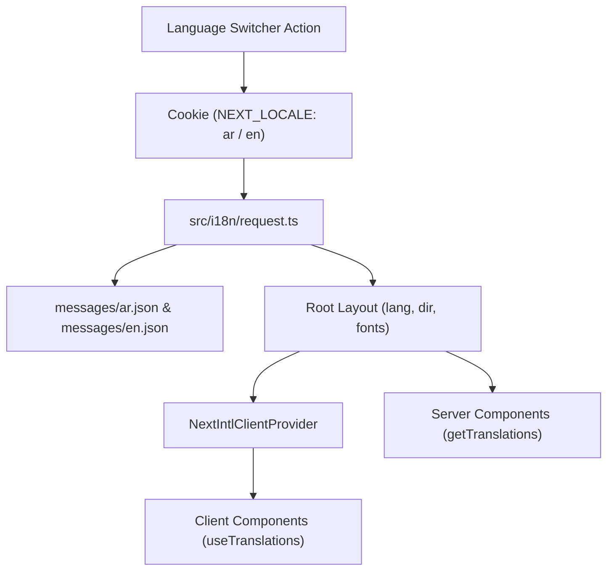

# خطة التنفيذ: نظام التدويل الشامل (Bilingual & RTL/LTR) لمتجر ROAROSA باستخدام `next-intl`

> **For agentic workers:** REQUIRED SUB-SKILL: Use superpowers:subagent-driven-development (recommended) or superpowers:executing-plans to implement this plan task-by-task. Steps use checkbox (`- [ ]`) syntax for tracking.

**Goal:** تحويل متجر ROAROSA الإلكتروني بالكامل إلى متجر ثنائي اللغة متكامل (العربية افتراضياً والإنجليزية اختيارياً) مع احترام فائق وتام للاتجاهات (RTL/LTR) والخطوط الفاخرة (`Cairo` للعربية و `Poppins` / `Playfair` للإنجليزية)، باستخدام مكتبة `next-intl` القياسية لـ Next.js 15 و React 19، والقضاء التام على أي محتوى نصي مكتوب يدوياً (Zero Hardcoded Text).

**Architecture:** 
- تفعيل معمارية `next-intl` بالاعتماد على الكوكيز (`NEXT_LOCALE`) عبر ملف إعدادات `src/i18n/request.ts` ومكون `NextIntlClientProvider` ومكونات السيرفر عبر `getTranslations`.
- الحفاظ على بنية الروابط الحالية (In-place Switching) دون الحاجة لإعادة هيكلة المجلدات إلى `[locale]` لتفادي أي مشاكل في مسارات المصادقة أو الصفحات.
- تحكم ديناميكي في خصائص `dir` و `lang` على وسم `<html>`، وتطبيق أنماط الاتجاه المنطقية (CSS Logical Properties) وانعكاس الأيقونات والقوائم المنبثقة والـ Drawer الجانبي تلقائياً.
- هيكلة ملفات القواميس في `messages/ar.json` و `messages/en.json` مع توفير دعم ثنائي اللغة لكاتالوج المنتجات `girlsCatalog.ts`.

**Tech Stack:** Next.js 15.5.22, React 19.1.0, `next-intl` ^4.14, Tailwind CSS v4, Lucide Icons, Redux Toolkit, Sonner.

---

## User Review Required

> [!IMPORTANT]
> **اللغة الافتراضية والتبديل**:
> - الموقع سيبدأ افتراضياً باللغة **العربية (RTL)** وفقاً لاختيارك مع خط **Cairo** الفاخر.
> - عند ضغط الزائر على زر التبديل إلى `English` في الـ Header أو القائمة الجانبية، يتم حفظ التفضيل فورياً في الـ Cookie (`NEXT_LOCALE`) ويتحول الموقع لحظياً إلى **LTR** مع خط **Poppins / Playfair**.
> - يتم تدويل كافة التنبيهات (Toast Notifications) ونماذج المصادقة (Auth Forms) وعناصر السلة والمفضلة والكاتالوج.

> [!NOTE]
> لن يتم تغيير أي مسار من روابط الموقع (ستظل الروابط نظيفة `/`, `/products`, `/cart`, إلخ)، مما يضمن عدم حدوث أي أخطاء في الروابط المخزنة أو مسارات الـ Auth Callbacks.

---

## Open Questions

- تم حسم جميع الأسئلة الجوهرية (الاعتماد على `next-intl`، التبديل الفوري عبر الكوكيز، اللغة العربية افتراضياً مع خط فاخر، وتغطية جميع الأقسام بنسبة 100%). لا توجد نقاط عالقة.

---

## Proposed Changes



---

### Component 1: التأسيس وحزم الاعتماد (Core Setup & i18n Config)

تثبيت `next-intl` وإعداد ملف التكوين ومحول الـ Next Config.

#### [MODIFY] `frontend/package.json`
- إضافة حزمة `next-intl` كـ dependency.

#### [NEW] `frontend/src/i18n/request.ts`
- إنشاء إعداد الطلب `getRequestConfig` من `next-intl/server` لقراءة الكوكي `NEXT_LOCALE` (الافتراضية: `'ar'`) وتحميل ملف الرسائل المطابق من `messages/${locale}.json`.

#### [MODIFY] `frontend/next.config.ts`
- تغليف إعدادات الـ Next بـ `createNextIntlPlugin('./src/i18n/request.ts')`.

#### [NEW] `frontend/src/app/_actions/language.action.ts`
- Server Action `setLanguage(locale: 'ar' | 'en')` لتعيين كوكي `NEXT_LOCALE` بأمان لمدة سنة كاملة.

---

### Component 2: القواميس الشاملة (Bilingual Dictionaries)

إنشاء ملفات النصوص الكاملة الخالية من الـ Hardcoding، مقسمة إلى أقسام دلالية:
- `Common`: أزرار عامة، اتجاهات، شارات، عملة (ج.م / EGP).
- `TopHeader`: شريط الإعلانات، الشحن المجاني، مركز المساعدة، اختيار اللغة.
- `Navbar`: الشعار، السلوجان، الروابط الرئيسية، قائمة الأقسام، الحساب، المفضلة، الحقيبة.
- `HeroBanner`: سلاسل الحملات الإعلانية، العناوين العريضة، الأزرار، تحكم الفيديو/الصور.
- `ShopByAge`: الفئات العمرية الأربع، المقاسات، أزرار التسوق.
- `ShopByCategory`: أسماء جميع الأقسام وتصنيفاتها.
- `TrendSpotlight`: تحريرات Next Direct، الفساتين المنسدلة، أزياء المناسبات.
- `GirlsTrendingSlider`: الأكثر رواجاً، شارات الجديد، إضافة للحقيبة، المعاينة السريعة.
- `BrandStory`: قصة ماركة ROAROSA، السلوجان (الرقة ليست ضعفاً)، الركائز الثلاث.
- `TrustFeatures`: ميزات الثقة والضمان، النعومة للبشرة الحساسة، الشحن السريع، الإرجاع المجاني.
- `Footer`: اشتراك نادي ROAROSA، كود الخصم 10%، روابط المساعدة، الفروع، بوابات الدفع.
- `Products`: مسار التنقل (Breadcrumbs)، عناوين البحث، فلاتر التصنيف، السعر، الفرز، نتائج البحث الفارغة.
- `ProductDetails`: اختيار المقاس، جدول المقاسات، تفاصيل الخامة، زر الإضافة، معرض الصور.
- `Cart`: مراجعة المنتجات، كود الكوبون، ملخص الطلب، الإجمالي، زر الدفع.
- `Wishlist`: قائمة الأمنيات، زر النقل للحقيبة، إفراغ المفضلة.
- `Auth`: تسجيل الدخول، إنشاء الحساب، استعادة كلمة المرور، التحقق من رمز OTP، رسائل الأخطاء.

#### [NEW] `frontend/messages/ar.json`
- ملف الترجمة العربية الكامل المصاغ بلغة عربية فصحى راقية تليق بعلامة أزياء فاخرة.

#### [NEW] `frontend/messages/en.json`
- ملف الترجمة الإنجليزية الكامل المنظم بنفس المفاتيح المتطابقة بدقة.

---

### Component 3: الخطوط والاتجاهات (Typography & Direction Layout)

#### [MODIFY] `frontend/src/app/layout.tsx`
- استيراد خط `Cairo` من `next/font/google`:
- قراءة الـ `locale` والـ `messages` عبر `getLocale()` و `getMessages()`.
- تعيين `dir={locale === 'ar' ? 'rtl' : 'ltr'}` و `lang={locale}` على وسم `<html>`.
- تغليف محتوى التطبيق بمكون `<NextIntlClientProvider locale={locale} messages={messages}>`.
- تطبيق كلاسات الخط العربي الفاخر عند تفعيل العربية.

#### [MODIFY] `frontend/src/app/globals.css`
- إضافة قواعد التحكم في الخطوط حسب الاتجاه:
- إضافة كلاسات مساعدة للانعكاس السلس للأيقونات في حالة RTL (`rtl:rotate-180`).

---

### Component 4: تعريب وتدويل الهيكل العام (Header, Navbar, Footer, Language Switcher)

#### [NEW] `frontend/src/_Components/shared/LanguageSwitcher/LanguageSwitcher.tsx`
- مكون زر تبديل اللغة التفاعلي:
  - يعرض للزائر `English` عندما تكون الواجهة بالعربية، و `العربية` عندما تكون بالإنجليزية.
  - أيقونة كوكب الأرض `Globe`.
  - يستدعي `setLanguageAction` ويقوم بعمل `router.refresh()` الفوري السلس.

#### [MODIFY] `frontend/src/_Components/layout/TopHeader/TopHeader.tsx`
- استبدال النصوص المكتوبة بـ `useTranslations('TopHeader')`.
- إدراج مكون `LanguageSwitcher` في الشريط العلوي بجوار العملة والـ Theme Toggle.

#### [MODIFY] `frontend/src/_Components/layout/Navbar/Navbar.tsx`
- استبدال نصوص الأقسام والروابط وأزرار الحساب والمفضلة والحقيبة بـ `useTranslations('Navbar')`.
- تحويل الـ Sheet Drawer الجانبي ليفتح من اليمين في العربية (`side={isRtl ? 'right' : 'left'}`).
- إضافة زر تبديل اللغة داخل القائمة الجانبية للموبايل.
- عكس اتجاه أيقونات الأسهم `ChevronDown` والروابط.

#### [MODIFY] `frontend/src/_Components/layout/Footer/Footer.tsx`
- استبدال كافة نصوص النشرة البريدية وروابط الفروع والمساعدة والأقسام والشهادات وحقوق الملكية بـ `useTranslations('Footer')`.
- تصحيح اتجاه الحقول والأزرار لتناسب RTL تلقائياً.

---

### Component 5: تعريب مكونات الصفحة الرئيسية (Home Sections)

#### [MODIFY] `frontend/src/_Components/home/HeroBanner/HeroBanner.tsx`
- استبدال نصوص الحملات الإعلانية ومسميات الأزرار وشريط الحركة بـ `useTranslations('HeroBanner')`.
- ضبط تموضع أزرار التحكم في الفيديو والكاميرا لتدعم `start` و `end` بدلاً من المواقع الثابتة.

#### [MODIFY] `frontend/src/_Components/home/ShopByAge/ShopByAge.tsx`
- ربط بطاقات الأعمار الأربعة بقاموس `ShopByAge` باللغتين.
- احترام اتجاه البطاقات وأزرار التصفح.

#### [MODIFY] `frontend/src/_Components/home/ShopByCategory/ShopByCategory.tsx`
- استبدال مسميات الأقسام الدائرية بـ `useTranslations('ShopByCategory')`.

#### [MODIFY] `frontend/src/_Components/home/TrendSpotlight/TrendSpotlight.tsx`
- استبدال نصوص حملات "The Edits" والتفاصيل الدقيقة للأقمشة والفساتين بالترجمات المعتمدة.

#### [MODIFY] `frontend/src/_Components/home/GirlsTrendingSlider/GirlsTrendingSlider.tsx`
- استبدال عناوين السلايدر وشارات التقييم والمبيعات بالنصوص المترجمة.
- تفعيل خاصية RTL في إعدادات Swiper لتنزلق الشرائح بسلاسة وفق الاتجاه الحالي.

#### [MODIFY] `frontend/src/_Components/home/BrandStory/BrandStory.tsx`
- استبدال قصة الماركة وفلسفة "الرقة ليست ضعفاً" والركائز الثلاث بالنصوص المترجمة الراقية.

#### [MODIFY] `frontend/src/_Components/home/TrustFeatures/TrustFeatures.tsx`
- استبدال ميزات الضمان والخدمات بـ `useTranslations('TrustFeatures')`.

---

### Component 6: تعريب صفحات المنتجات والتصفية (Products & Product Details)

#### [MODIFY] `frontend/src/data/girlsCatalog.ts`
- توفير مصفوفة ثنائية اللغة أو دالة ترجمة للمنتجات `getLocalizedProducts(locale)` تتيح عرض أسماء المنتجات وأوصافها وتصنيفاتها إما بالعربية أو بالإنجليزية دون أي hardcoding.

#### [MODIFY] `frontend/src/app/(public)/products/page.tsx`
- استبدال نصوص مسار التنقل (Breadcrumbs)، عداد المنتجات المعروضة، وعناوين الفئات بـ `getTranslations('Products')`.
- عكس اتجاه سهم مسار التنقل `ChevronRight` في RTL (`rtl:rotate-180`).
- تعريب رسالة "لم يتم العثور على نتائج" وزر إعادة التعيين.

#### [MODIFY] `frontend/src/_Components/shared/FilterGroup/FilterGroup.tsx`
#### [MODIFY] `frontend/src/_Components/shared/FilterProductSorting/FilterProductSorting.tsx`
#### [MODIFY] `frontend/src/_Components/shared/FilterByPriceRange/FilterByPriceRange.tsx`
- تعريب خيارات الفرز (الأحدث، السعر من الأقل للأعلى، السعر من الأعلى للأقل، الأكثر رواجاً).
- تعريب مسميات الفلاتر ومحدد نطاق السعر بالجنيه المصري.

#### [MODIFY] `frontend/src/app/(public)/productDetails/[id]/page.tsx`
- تعريب زر إضافة للحقيبة، زر المفضلة، محدد المقاس، شارة العناية بالبشرة الحساسة، وسياسات التوصيل والإرجاع.

---

### Component 7: تعريب السلة والمفضلة والمصادقة (Cart, Wishlist & Auth)

#### [MODIFY] `frontend/src/app/(public)/cart/page.tsx`
- استبدال نصوص السلة، كود الخصم، ملخص الطلب، الإجمالي الفرعي، الشحن، وزر المتابعة للدفع بـ `useTranslations('Cart')`.

#### [MODIFY] `frontend/src/app/(public)/wishlist/page.tsx`
- تعريب نصوص المفضلة، وحالة القائمة الفارغة.

#### [MODIFY] `frontend/src/app/(Auth)/login/LoginForm.tsx`
#### [MODIFY] `frontend/src/app/(Auth)/register/RegisterForm.tsx`
#### [MODIFY] `frontend/src/app/(Auth)/forgetPassword/forgetForm.tsx`
#### [MODIFY] `frontend/src/app/(Auth)/otpValidation/OtpValidationForm.tsx`
- تعريب جميع عناوين الحقول، النصوص التوضيحية (Placeholders)، أزرار الإرسال، ورسائل التحقق من الصحة (Validation Schema Error Messages).

---

## Verification Plan

### Automated Tests
1. فحص حزمة `next-intl` وبناء المشروع بالكامل للتأكد من انعدام أخطاء الـ TypeScript والـ Build:
   ```powershell
   npm --prefix frontend run build
   ```
2. فحص الـ Lint والتأكد من توافق القواعد وخلو الملفات من الأخطاء:
   ```powershell
   npm --prefix frontend run lint
   ```

### Manual Verification
1. **التحقق من الوضع الافتراضي (العربية)**:
   - التأكد من `dir="rtl"` و `lang="ar"` وتطبيق خط `Cairo`.
   - مراجعة كافة المكونات للتأكد من عدم وجود أي كلمات hardcoded.
2. **التحقق من التبديل الفوري إلى الإنجليزية**:
   - النقر على زر التبديل والتحقق من تحول الموقع إلى `dir="ltr"` و `lang="en"`.
   - التأكد من ثبات الاختيار بعد تحديث الصفحة (Cookies).
3. **التحقق من تجربة الموبايل**:
   - التأكد من فتح القائمة الجانبية من اليمين في العربية ومن اليسار في الإنجليزية.
